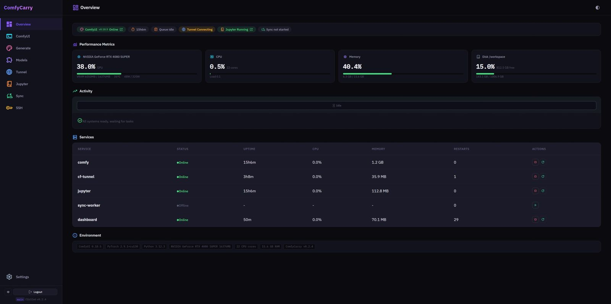
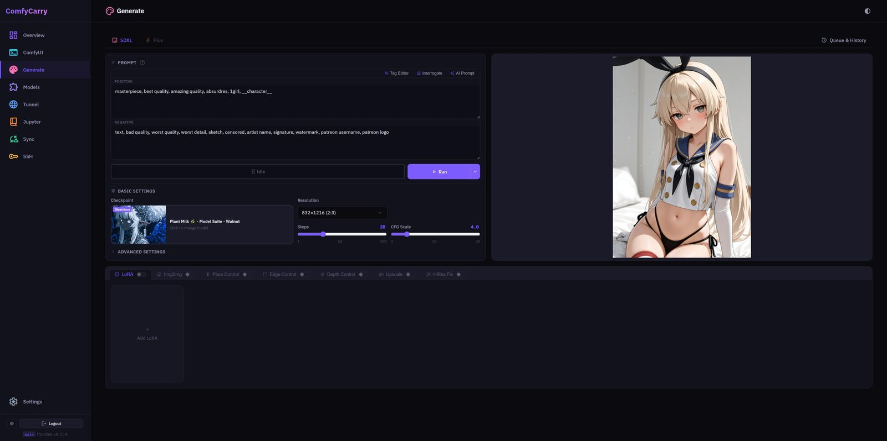
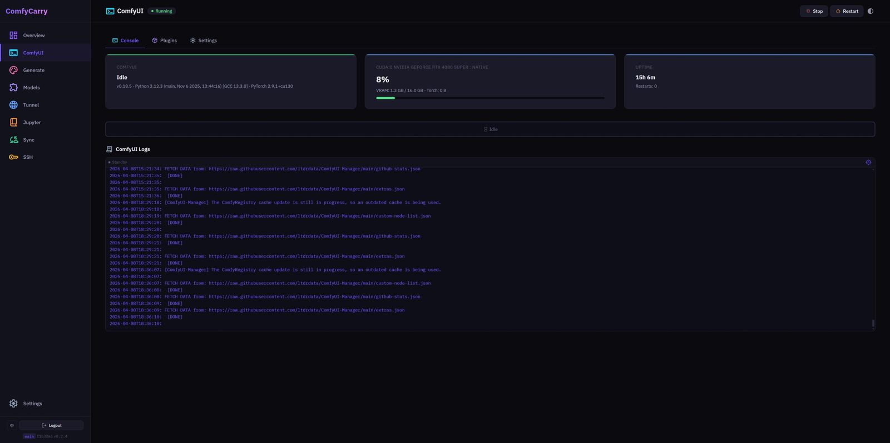
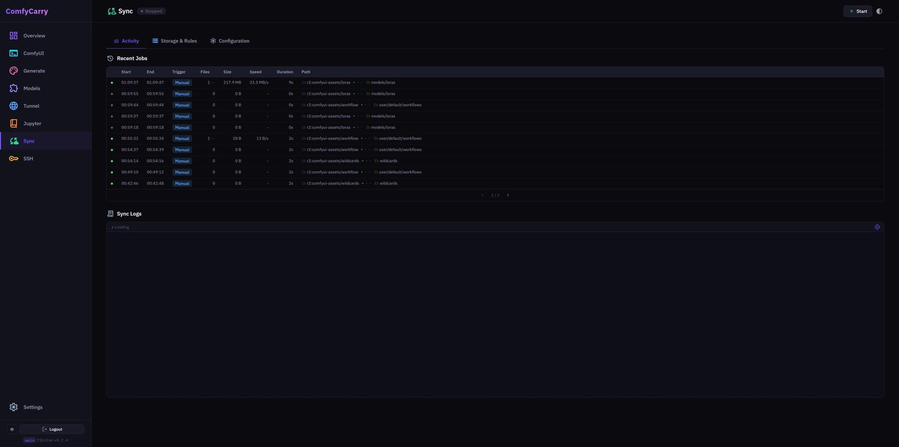

# ComfyCarry

[English](README.md) | 中文

RunPod / Vast.ai 上的 ComfyUI 云端管理平台。用完即毁的实例，永不丢失的配置。



<p align="center">
  
  
</p>
<p align="center">
  
  
</p>

---

## 功能

Web Dashboard 管理 ComfyUI 全生命周期：

- **一键部署** — Setup Wizard 引导完成全部配置，自动安装 ComfyUI、插件、依赖
- **系统监控** — GPU / CPU / VRAM / 磁盘实时状态，PM2 服务管理
- **图片生成** — SDXL / Flux 文生图，支持 LoRA、ControlNet、Img2Img、超分、二次采样，工作流自动构建
- **模型管理** — 本地模型浏览 + CivitAI 搜索下载，下载队列与状态持久化
- **插件管理** — 代理 ComfyUI-Manager，浏览 / 安装 / 更新 / 卸载
- **ComfyUI 控制** — 启动参数热改、实时日志流、队列 / 历史管理
- **Tunnel** — Cloudflare 公共节点 + 自定义 Tunnel 双模式，多服务 DNS 管理
- **云同步** — Rclone 双向同步，规则引擎控制同步策略，Job 历史与统计
- **JupyterLab** — 启动 / 停止、内核 / Session / Terminal 控制
- **SSH** — SSH 服务管理、公钥管理、Root 密码配置
- **配置迁移** — 导出 / 导入全部设置为 JSON，新实例秒级恢复

---

## 快速开始

### 1. 创建实例

在 Vast.ai / RunPod 创建 GPU 实例，选择预构建镜像：

```
erocraft/comfycarry:latest
```

基于 Python 3.13 + PyTorch 2.11.0 + CUDA 13.0，内含 FlashAttention-2、SageAttention-2、ComfyUI 及 21 个常用插件。启动耗时 2-5 分钟。

#### 镜像命名与版本

Docker Hub 的 `erocraft/comfycarry` 和 GHCR 的 `ghcr.io/vvb7456/comfycarry` 使用相同标签：

| 标签 | 用途 | 镜像内名称示例 |
|------|------|----------------|
| `latest`、`x86` | 最新 x86 镜像，两者指向同一镜像 | `ComfyCarry v3.3.0 (x86)` |
| `arm` | 最新 ARM64 / GB10 镜像 | `ComfyCarry v3.3.0 (arm)` |
| `v3.3.0-x86`、`v3.3.0-arm` | Python 3.13 / PyTorch 2.11.0 | 与对应版本一致 |
| `v3.2.0-x86`、`v3.2.0-arm` | Python 3.12 / PyTorch 2.9.1 | 与对应版本一致 |

镜像版本统一维护在 `docker/VERSION`，采用 `主版本.次版本.修订版本` 格式，与客户端 Release 版本独立。发布新镜像时先更新此文件：小修复递增修订版本，新增功能递增次版本，重大变更递增主版本。CUDA、PyTorch 版本保留在镜像信息中。

修改镜像构建文件或 `docker/VERSION` 并推送到 `main`，CI 会同时构建两种架构，生成标签和镜像内名称。也可以运行 `bash docker/build.sh` 手动触发 `main` 分支的 CI 构建。

预编译加速包按运行环境分别保存：

- [Python 3.12 / PyTorch 2.9.1 / CUDA 13.0](https://github.com/vvb7456/ComfyCarry/releases/tag/wheels-v1)
- [Python 3.13 / PyTorch 2.11.0 / CUDA 13.0](https://github.com/vvb7456/ComfyCarry/releases/tag/wheels-py313-torch2.11.0-cu130)

Python 3.13 的全量编译入口为 `bash docker/build-attention-wheels.sh`，自动按本机 CPU 架构生成对应 wheel。编译环境需要 Python 3.13、PyTorch 2.11.0 + CUDA 13.0，以及 CUDA 编译工具和 cuBLAS/cuSPARSE/cuSOLVER 开发头文件。新包文件名记录 Python、PyTorch、CUDA 和目标架构。

### 2. 设置启动命令

在 **On-start Script** 中填写：

```bash
wget -qO- https://raw.githubusercontent.com/vvb7456/ComfyCarry/main/bootstrap.sh | bash
```

### 3. 访问 Dashboard

打开 `http://<实例IP>:5000`，首次进入 Setup Wizard：

| 步骤 | 配置项 |
|------|--------|
| 部署方式 | 全新部署 / 从 JSON 恢复 |
| 密码 | Dashboard 登录密码 |
| Tunnel | Cloudflare Tunnel Token |
| 云存储 | Rclone 配置 + 同步偏好 |
| CivitAI | API Key |
| Attention | FlashAttention / SageAttention 选择 |
| 插件 | 选择要安装的自定义节点 |
| 确认 | 一键部署，实时日志 |

部署完成自动跳转主界面。

### Google Colab

在 Colab 选择最新的 GPU 运行时（Python 3.13 / PyTorch 2.11.0 / CUDA 13.0），在代码单元格运行：

```bash
!curl -fsSL https://raw.githubusercontent.com/vvb7456/ComfyCarry/main/colab.sh | bash
```

安装器直接使用 Colab 自带的 Python、PyTorch 和 CUDA，将 ComfyUI 安装到工作区，补齐应用依赖，并安装当前 GPU 对应的加速包。随后通过 `bootstrap.sh` 下载正式 Release 部署包，启动面板和 JupyterLab。打开输出中的地址，使用部署向导配置密码、存储和插件。默认工作区为 `/content`，T4 使用默认 Attention。

重复执行可重新启动并复用现有安装。需要重新下载最新正式 Release 时，在命令中的 `bash` 前加上 `FORCE_UPDATE=true`。安装日志位于 `/content/colab-install.log`。

---

## 预装插件

镜像内置 21 个插件：

ComfyUI-Manager, comfyui_controlnet_aux, ComfyUI-Impact-Pack, ComfyUI-Impact-Subpack, ComfyUI-Easy-Use, ComfyUI-Crystools, ComfyUI_UltimateSDUpscale, comfyui-dynamicprompts, AuraSR-ComfyUI, was-node-suite-comfyui, ComfyUI-KJNodes, ComfyUI-WD14-Tagger, rgthree-comfy, ComfyUI-Inspire-Pack, ComfyUI-Custom-Scripts, ComfyUI-GGUF, ComfyUI_IPAdapter_plus, ComfyUI-VideoHelperSuite, ComfyUI_essentials, ComfyUI-RMBG, ComfyUI-SeedVR2_VideoUpscaler

---

## 环境变量

均为可选，Setup Wizard 会自动检测并预填充。

| 变量 | 说明 | 默认 |
|------|------|------|
| `DASHBOARD_PASSWORD` | 登录密码 | `comfy2025` |
| `CF_API_TOKEN` | Cloudflare API Token，用于自动创建 Tunnel | — |
| `CF_DOMAIN` | Cloudflare 托管域名 | — |
| `CF_SUBDOMAIN` | Tunnel 子域名前缀 | — |
| `CIVITAI_TOKEN` | CivitAI API Key | — |
| `RCLONE_CONF_BASE64` | Base64 编码的 rclone.conf | — |
| `WORKSPACE_DIR` | 工作区根目录 (面板路径约定里的 `/`) | `/workspace` |
| `COMFYUI_DIR` | ComfyUI 路径 | `$WORKSPACE_DIR/ComfyUI` |
| `COMFYUI_URL` | ComfyUI 内部 URL | `http://localhost:8188` |
| `MANAGER_PORT` | Dashboard 端口 | `5000` |
| `FORCE_UPDATE` | 强制重新下载 Dashboard 文件 | `false` |
| `PUBLIC_TUNNEL` | 自动启用公共 Tunnel | — |
| `SSH_PUBLIC_KEY` | SSH 公钥 | — |

---

## 架构

### 后端 — Flask

```
comfycarry/
├── app.py                        # App 工厂 + 启动逻辑
├── config.py                     # 全局配置
├── auth.py                       # 认证中间件
├── db.py                         # SQLite WAL + 事务
├── schema.py                     # 当前完整数据库结构
├── routes/                       # 15 个路由蓝图
│   ├── system / comfyui / models / plugins / tunnel
│   ├── sync / jupyter / settings / setup / ssh
│   ├── generate / downloads / files / frontend / llm
└── services/
    ├── comfyui_bridge.py         # WS→SSE 桥接
    ├── deploy_engine.py          # 部署引擎
    ├── sync_engine.py            # 同步引擎 + Rclone JSON 日志解析
    ├── sync_store.py             # Sync 持久化层
    ├── download_engine.py        # 下载队列
    ├── download_store.py         # 下载持久化层
    ├── download_events.py        # 下载事件与文件状态查询
    ├── download_completion.py    # 下载文件登记
    ├── tunnel_manager.py         # CF Tunnel 管理
    ├── workflow_builder.py       # 工作流构建器
    ├── civitai_resolver.py       # CivitAI 模型解析
    └── llm_engine.py             # LLM 提示词扩写
```

### 前端 — Vue 3 SPA

```
frontend/src/
├── pages/                        # 9 个路由页面 (懒加载)
├── components/
│   ├── ui/                       # 36+ 可复用基础组件
│   ├── layout/                   # AppSidebar, PageHeader
│   ├── form/                     # FormField, BaseInput, BaseSelect 等
│   ├── models/                   # 模型浏览器组件
│   ├── generate/                 # Generate 页面子组件
│   ├── sync/                     # Sync Activity 组件
│   └── wizard/                   # Setup Wizard 步骤
├── composables/                  # 可复用组合式函数
├── stores/                       # Pinia stores (app + generate)
├── i18n/locales/{en,zh-CN}/      # 国际化 (13 个命名空间)
└── css/                          # CSS 变量设计系统 (dark/light)
```

Vite 6 + TypeScript 5.9 + Vue 3.5 + Pinia 3 + vue-i18n 11。构建输出到 `static/dist/`，Flask 直接 serve。

### PM2 进程

| 名称 | 服务 | 端口 |
|------|------|------|
| `dashboard` | Flask 后端 | 5000 |
| `comfy` | ComfyUI | 8188 |
| `cf-tunnel` | Cloudflared | — |
| `jupyter` | JupyterLab | 8888 |

Sync Worker 在 Dashboard 进程内的后台线程运行。

---

## 常用命令

```bash
pm2 ls                    # 查看所有服务
pm2 logs dashboard        # Dashboard 日志
pm2 logs comfy            # ComfyUI 日志
pm2 restart comfy         # 重启 ComfyUI
```

---

## 许可证

本项目基于 [GNU Affero 通用公共许可证 v3.0 (AGPL-3.0)](LICENSE) 授权。

如需商业许可，请联系项目维护者。
